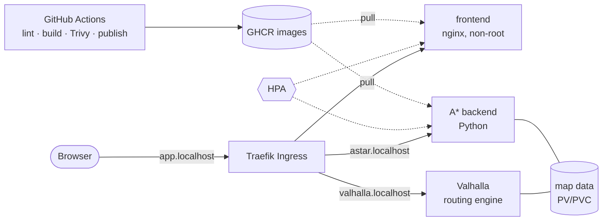

# Tokyo Routing Platform

A routing web app for central Tokyo, built as a hands-on DevOps project. A MapLibre frontend asks two independent routing engines for the same trip and draws both: **Valhalla** (a production routing engine, blue) and a **custom A\* backend** written in Python (red, dashed).


The application is the vehicle. The project is the engineering around it: containers, CI with security gating, Kubernetes packaging with Helm, autoscaling, and infrastructure as code. Everything runs locally or on free GitHub Actions runners, so it costs nothing to build or reproduce.

## Architecture



The browser talks to the backends directly: the frontend serves a small runtime `config.js` (mounted from a ConfigMap in Kubernetes) that tells it which URLs to call. That keeps **one image for every environment**, so the image CI scans and publishes is exactly the one that runs.

## What ran where

This table is deliberately blunt. Code that was written and validated but never executed is labelled as such.

| Piece | Status |
|---|---|
| Docker Compose stack, bootstrap script | Ran locally |
| CI: Dockerfile lint, image build, Trivy scan, publish to GHCR | Ran on GitHub Actions |
| Kubernetes manifests validation (kubeconform) and chart lint | Ran on GitHub Actions |
| Helm chart, Traefik Ingress, HPA, metrics-server | Ran on a local `kind` cluster |
| `values-prod.yaml` | Rendered and schema-validated in CI only. **Never installed.** It contains placeholder hostnames and assumes a storage class that does not exist locally |
| Any cloud (AWS, GCP) | **Not used.** No cloud resources were ever created |

## Quick start

Requirements: Docker, `curl`, Bash. For the Kubernetes path also `kind`, `kubectl` and `helm`.

### 1. Docker Compose

```bash
./scripts/bootstrap.sh
```

The script checks prerequisites, downloads the Tokyo-center OSM extract and a regional extract for Valhalla if they are missing, then runs `docker compose up --wait`. It is idempotent. **The first run builds Valhalla's routing tiles and takes about 40 minutes** (measured: ~38 minutes on 2 threads); later runs start in seconds. Then open http://localhost:8080.

### 2. Kubernetes on kind

Stop the Compose stack first (`docker compose stop`) so the ports are free, and make sure `data/` already holds the tiles from step 1.

```bash
# edit k8s/kind-config.yaml: set extraMounts.hostPath to the absolute path of this repo's data/ folder
kind create cluster --config k8s/kind-config.yaml
kubectl apply -f k8s/metrics-server.yaml          # needed by the HPA; dev-only TLS flag, see the file
helm upgrade --install traefik oci://ghcr.io/traefik/helm/traefik --version 42.0.0 \
  -n traefik --create-namespace -f k8s/traefik-values.yaml
helm upgrade --install routing charts/routing -n routing --create-namespace \
  -f charts/routing/values-dev.yaml
```

Open http://app.localhost:8088 (browsers resolve `*.localhost` to your own machine; for `curl` send a `Host:` header to `127.0.0.1:8088`).

## Repository layout

| Path | What it is |
|---|---|
| `backend/` | A\* routing service (Python standard library only), multi-stage Dockerfile, non-root, `/health` endpoint |
| `frontend/` | Static MapLibre app on non-root nginx; `config.js` holds runtime backend URLs |
| `docker-compose.yml` | Local stack with health-gated startup order |
| `scripts/bootstrap.sh` | One-command setup (`set -euo pipefail`, pre-flight checks, atomic downloads) |
| `charts/routing/` | Helm chart: Deployments, Services, Ingress, ConfigMaps, optional Secret, HPA, dev/prod values |
| `k8s/` | kind cluster config, Traefik values, vendored metrics-server |
| `.github/workflows/ci.yml` | CI pipeline (see below) |

## CI pipeline

Runs on every pull request and every push to `main`:

1. **hadolint** lints each Dockerfile.
2. **Manifests job** validates raw manifests and the **rendered** Helm chart (dev and prod values) against Kubernetes 1.34 schemas with `kubeconform -strict`, after `helm lint --strict`.
3. **Build** builds each image after lint passes, then **Trivy** scans it and fails the build on fixable HIGH/CRITICAL vulnerabilities.
4. **Publish** (push to `main` only) pushes the exact scanned image to GHCR tagged `sha-<commit>`. It needs both the build/scan and the manifest validation to pass, and it is the only job with `packages: write`.

Third-party tools are pinned by version and checksum or commit SHA, and the token is read-only by default.

## Engineering decisions

- **Scan gates publishing, and the scanned image is the published image.** The build job saves the scanned image as an artifact and the publish job pushes that file, instead of rebuilding. A rebuild "probably" yields the same layers; this guarantees it.
- **SHA-pinned security tooling.** While the Trivy action was being pinned, its release notes revealed a supply-chain attack earlier this year (its tags were migrated in response). Tags can be moved and commit SHAs cannot, so it is pinned by SHA. `kubeconform` and Helm are pinned by SHA-256 of the downloaded binary.
- **A real finding from the scan.** The first Trivy run failed the frontend image: 41 fixable vulnerabilities (2 critical, mostly OpenSSL) in an old Alpine base inherited from a frozen nginx line. Bumping the base fixed it. The backend passed because its base image is actively rebuilt.
- **Replaced a retired component.** The standard choice, `ingress-nginx`, turned out to be archived (maintenance ended March 2026), so the cluster uses Traefik with a pinned chart and only the standard Ingress provider enabled.
- **A cross-platform bug found by reading a diff.** Helm checksum annotations (used to restart pods when config changes) hash template *text*. A Windows checkout with CRLF endings produced a different hash than Linux, causing spurious restarts of Valhalla (which uses a `Recreate` strategy, so each one is downtime). `.gitattributes` now forces LF everywhere, and a second `helm upgrade` is verified to change nothing.
- **Valhalla is not autoscaled.** It writes to a `ReadWriteOnce` volume that its entrypoint modifies, so a second replica would be a second writer on the same files. Only the stateless A\* backend and frontend have HPAs.
- **Probes match the startup behavior.** The A\* backend builds its road graph before it listens, so a `startupProbe` holds off liveness and readiness checks instead of letting them kill the pod mid-start.
- **Documented hardening exception.** The A\* and frontend pods run with a read-only root filesystem, no privilege escalation and all capabilities dropped. Valhalla's image runs its commands through `sudo`, so it cannot take those settings. It still runs as a non-root user, and the manifest says why.

## Cost

$0. Compose and `kind` run on a laptop, CI uses free GitHub Actions minutes, and images live on GHCR. No cloud account is required.

## Known limitations

- **Resource numbers are estimates until the load test (planned).** A smoke test scaled the A\* backend from 1 to 3 replicas within about 30 seconds while each replica saturated roughly one CPU core. It is a single-threaded Python server, and its CPU request (100m) is too low for that. Proper thresholds come from a measured load test.
- **The timings in the screenshot are one request, not a benchmark.**
- **`values-prod.yaml` is not installed anywhere.** Shared storage across nodes (the data volume is read by several pods) is an open design question there.
- The app has no real secrets today, so the chart's Secret is an optional, empty mechanism.
- The Windows paths in `k8s/kind-config.yaml` must be edited for another machine.
