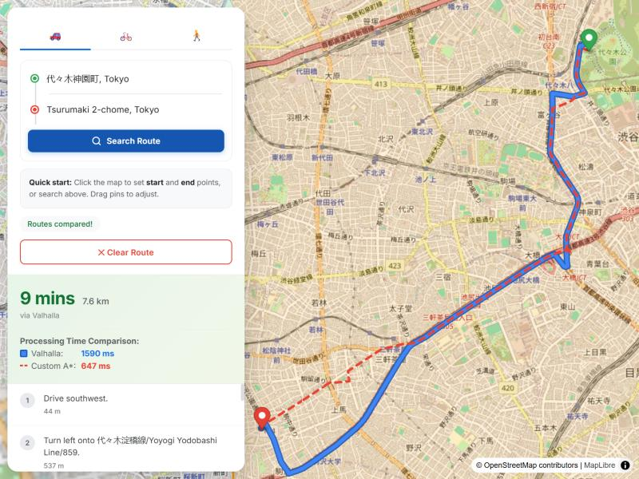
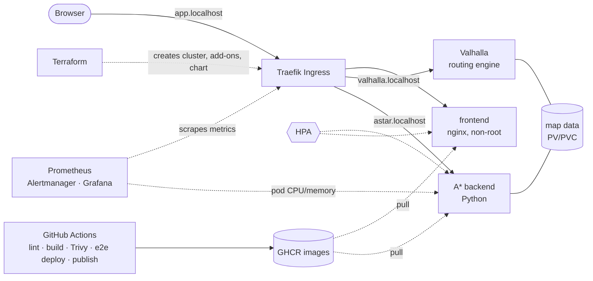

# Tokyo Routing Platform

A routing web app for central Tokyo, built as a hands-on DevOps project. A MapLibre frontend asks two independent routing engines for the same trip and draws both: **Valhalla** (a production routing engine, blue) and a **custom A\* backend** written in Python (red, dashed).



The application is the vehicle. The project is the engineering around it: containers, CI with security gating, Kubernetes packaging with Helm, autoscaling, monitoring, load testing, and infrastructure as code. Everything runs locally or on free GitHub Actions runners, so it costs nothing to build or reproduce.

## Results at a glance

- **Pipeline:** every pull request is linted, built, vulnerability-scanned, deployed to an ephemeral cluster, smoke-tested, deliberately broken and rolled back, and only then can its images be published.
- **Capacity (measured):** one A\* replica saturates at about **3 requests/s**, one Valhalla replica at about **30 requests/s**. The autoscaler was validated under overload: new replicas within seconds, p95 latency back to 0.49 s after about 80 s. ([report](docs/capacity-report.md))
- **Monitoring:** Prometheus, Alertmanager and Grafana with a 10-panel dashboard and 4 alert rules. A deliberate outage proved the alerts fire, and exposed one that could not. ([details](docs/monitoring.md))
- **Infrastructure as code:** the whole local environment from one `terraform apply` (and gone with one `terraform destroy`); an AWS/EKS design that is validated and scanned but **never applied**. ([what ran where](#what-ran-where))

## Architecture



The browser talks to the backends directly: the frontend serves a small runtime `config.js` (mounted from a ConfigMap in Kubernetes) that tells it which URLs to call. That keeps **one image for every environment**, so the image CI scans and publishes is exactly the one that runs.

## What ran where

This table is deliberately blunt. Code that was written and validated but never executed is labelled as such.

| Piece | Status |
|---|---|
| Docker Compose stack, bootstrap script | Ran locally |
| CI: Dockerfile lint, image build, Trivy scan, publish to GHCR | Ran on GitHub Actions |
| Kubernetes manifests validation (kubeconform) and chart lint | Ran on GitHub Actions |
| Helm chart, Traefik Ingress, HPA, metrics-server | Ran on a local `kind` cluster |
| End-to-end deploy test: ephemeral cluster, smoke test, deliberately broken deploy, `helm rollback` | Ran on GitHub Actions (every pull request and push) |
| `terraform/local`: the local cluster, add-ons and chart as code | Ran locally: `apply`, `plan` (no drift), `destroy`, `apply` again |
| Load tests (k6) and the autoscaler validation | Ran locally against the `kind` cluster (`docs/capacity-report.md`) |
| Prometheus, Alertmanager, Grafana, the dashboard and alert rules | Ran on the local `kind` cluster; alerts were made to fire by deliberately taking Valhalla down (see `docs/monitoring.md`) |
| `terraform/aws-reference`: VPC, EKS, ECR, GitHub OIDC role, S3 | Formatted, validated and security-scanned in CI. **Never applied** |
| `values-prod.yaml` | Rendered and schema-validated in CI only. **Never installed.** It contains placeholder hostnames and assumes a storage class that does not exist locally |
| Any cloud (AWS, GCP) | **Not used.** No cloud resources were ever created |

## Quick start

Requirements: Docker, `curl`, Bash. For the Kubernetes path also `kind`, `kubectl` and `helm`.

### 1. Docker Compose

```bash
./scripts/bootstrap.sh
```

The script checks prerequisites, downloads the Tokyo-center OSM extract and a regional extract for Valhalla if they are missing, then runs `docker compose up --wait`. It is idempotent. **The first run builds Valhalla's routing tiles and takes about 40 minutes** (measured: ~38 minutes on 2 threads); later runs start in seconds. Then open http://localhost:8080.

### 2. Kubernetes on kind

Stop the Compose stack first (`docker compose stop`) so the ports are free, and make sure `data/` already holds the tiles from step 1.

```bash
# edit k8s/kind-config.yaml: set extraMounts.hostPath to the absolute path of this repo's data/ folder
kind create cluster --config k8s/kind-config.yaml
kubectl apply -f k8s/metrics-server.yaml          # needed by the HPA; dev-only TLS flag, see the file
helm upgrade --install traefik oci://ghcr.io/traefik/helm/traefik --version 42.0.0 \
  -n traefik --create-namespace -f k8s/traefik-values.yaml
helm upgrade --install routing charts/routing -n routing --create-namespace \
  -f charts/routing/values-dev.yaml
```

Open http://app.localhost:8088 (browsers resolve `*.localhost` to your own machine; for `curl` send a `Host:` header to `127.0.0.1:8088`). To check the whole deployment through the Ingress: `./scripts/smoke-test.sh`.

**The same thing as code:** `terraform/local` creates the cluster, Traefik, metrics-server and the chart with one `terraform apply` (and removes them with `terraform destroy`). See `terraform/local/README.md`.

**Monitoring comes only with the Terraform path.** The manual commands above do not install Prometheus or Grafana, so the chart's dashboard and alert rules stay off (`monitoring.enabled=false`). Terraform installs the monitoring stack and turns them on; see `docs/monitoring.md`.

## Repository layout

| Path | What it is |
|---|---|
| `backend/` | A\* routing service (Python standard library only), multi-stage Dockerfile, non-root, `/health` endpoint |
| `frontend/` | Static MapLibre app on non-root nginx; `config.js` holds runtime backend URLs |
| `docker-compose.yml` | Local stack with health-gated startup order |
| `scripts/bootstrap.sh` | One-command setup (`set -euo pipefail`, pre-flight checks, atomic downloads) |
| `charts/routing/` | Helm chart: Deployments, Services, Ingress, ConfigMaps, optional Secret, HPA, dev/prod values |
| `k8s/` | kind cluster config, Traefik values, vendored metrics-server |
| `terraform/local/` | The local cluster, add-ons and chart as Terraform (applied and verified locally) |
| `terraform/aws-reference/` | EKS/VPC/ECR/OIDC/S3 reference design: validated and scanned, never applied |
| `ci/` | Cropped map fixture (10.7k nodes) and config for the CI end-to-end test, plus the script that regenerates it |
| `scripts/smoke-test.sh` | End-to-end checks through the Ingress; used by CI and runnable locally |
| `docs/monitoring.md` | What is measured, the alert rules, and the monitoring problems found and fixed |
| `docs/capacity-report.md` | Load-test results, the saturation point of each service, and the settings derived from them |
| `loadtest/` | k6 script, step-test runner, autoscaler validation, charts, verified test trips and raw results |
| `k8s/monitoring-values.yaml` | kube-prometheus-stack settings for the local cluster |
| `.github/workflows/ci.yml` | CI pipeline (see below) |

## CI pipeline

Runs on every pull request and every push to `main`:

1. **hadolint** lints each Dockerfile.
2. **Manifests job** validates raw manifests and the **rendered** Helm chart (dev and prod values) against Kubernetes 1.34 schemas with `kubeconform -strict`, after `helm lint --strict`.
3. **Build** builds each image after lint passes, then **Trivy** scans it and fails the build on fixable HIGH/CRITICAL vulnerabilities.
4. **End-to-end deploy** starts an ephemeral `kind` cluster, loads the images built and scanned in the same run, installs Traefik and the chart, and smoke-tests real routes through the Ingress. It then deploys a release with a nonexistent image tag on purpose, checks that the failure is reported and the service stays up, rolls back with `helm rollback`, and smoke-tests again. It uses a cropped map fixture so both routing engines work in CI.
5. **Alert rules** are rendered from the chart and checked with Prometheus's own `promtool`, and the dashboard JSON is sanity-checked.
6. **Terraform and secrets** runs `fmt`, `init -backend=false` and `validate` on both Terraform directories, a Trivy misconfiguration scan of the AWS reference code, and a secret scan of the whole repository.
7. **Publish** (push to `main` only) pushes the exact scanned image to GHCR tagged `sha-<commit>`. It needs the build/scan, manifest validation, end-to-end deploy and Terraform/secret checks to pass, and it is the only job with `packages: write`.

**Pinning:** every GitHub Action is pinned to a full commit SHA (the tag it came from is kept in a comment), and every downloaded tool (`kubeconform`, Helm, `kind`, Terraform) is pinned by version and SHA-256, and the `promtool` image by digest. A tag can be moved by its maintainer; a SHA cannot. Dependabot (`.github/dependabot.yml`) proposes updates weekly, and each one goes through the same CI before it can merge. The workflow token is read-only by default.

## Engineering decisions

- **Scan gates publishing, and the scanned image is the published image.** The build job saves the scanned image as an artifact and the publish job pushes that file, instead of rebuilding. A rebuild "probably" yields the same layers; this guarantees it.
- **SHA-pinned security tooling.** While the Trivy action was being pinned, its release notes revealed a supply-chain attack earlier this year (its tags were migrated in response). Tags can be moved and commit SHAs cannot, so it is pinned by SHA. `kubeconform` and Helm are pinned by SHA-256 of the downloaded binary.
- **A real finding from the scan.** The first Trivy run failed the frontend image: 41 fixable vulnerabilities (2 critical, mostly OpenSSL) in an old Alpine base inherited from a frozen nginx line. Bumping the base fixed it. The backend passed because its base image is actively rebuilt.
- **Replaced a retired component.** The standard choice, `ingress-nginx`, turned out to be archived (maintenance ended March 2026), so the cluster uses Traefik with a pinned chart and only the standard Ingress provider enabled.
- **A cross-platform bug found by reading a diff.** Helm checksum annotations (used to restart pods when config changes) hash template *text*. A Windows checkout with CRLF endings produced a different hash than Linux, causing spurious restarts of Valhalla (which uses a `Recreate` strategy, so each one is downtime). `.gitattributes` now forces LF everywhere, and a second `helm upgrade` is verified to change nothing.
- **Valhalla is not autoscaled.** It writes to a `ReadWriteOnce` volume that its entrypoint modifies, so a second replica would be a second writer on the same files. Only the stateless A\* backend and frontend have HPAs.
- **A deploy pipeline without a cloud.** The end-to-end job proves what a CD pipeline should prove: the artifact deploys, a bad release fails visibly instead of silently, the old version keeps serving during the failed rollout, and rollback restores a working state, all asserted by a script and not by eye.
- **Resource settings come from measurement, not guesses.** A load test found one A\* replica saturates at ~3 req/s (it uses exactly one core) and Valhalla at ~30 req/s. The original 100m CPU request made the autoscaler trigger at around 0.3 req/s; it is now 600m, so it scales out at roughly half the saturation point. The autoscaler was then validated under overload: it added replicas within seconds and latency recovered in about 80 s.
- **An alert that could not fire, found by testing it.** The first error-rate alert watched per-service 5xx metrics. A deliberate outage (Valhalla scaled to zero) showed that Traefik answers `503` itself when a route has no backend and attributes nothing to the service, so that alert stayed silent while every request failed. An ingress-level alert and dashboard panel now cover it. Alerts need to be exercised, not just written.
- **A silent label collision.** Traefik and the Prometheus `ServiceMonitor` both set a `service` label, so Prometheus renamed Traefik's to `exported_service` and every dashboard query returned nothing, without an error. `honorLabels: true` fixes it.
- **A secret nearly committed, and caught.** The kind Terraform provider writes a kubeconfig (with client keys) beside the Terraform code, and a careless `git add` staged it into a local commit. Inspecting `git ls-files` caught it before any push; the commit was rewritten, the pattern ignored, and a repository-wide secret scan added to CI so this class of mistake fails the build.
- **IaC findings fixed, not silenced.** A Trivy scan of the AWS reference code found a public Kubernetes API endpoint (CRITICAL) and a bucket without a customer-managed key (HIGH). Both were fixed in the code. The one accepted finding (worker egress) is documented with its reason in `.trivyignore`.
- **Probes match the startup behavior.** The A\* backend builds its road graph before it listens, so a `startupProbe` holds off liveness and readiness checks instead of letting them kill the pod mid-start.
- **Documented hardening exception.** The A\* and frontend pods run with a read-only root filesystem, no privilege escalation and all capabilities dropped. Valhalla's image runs its commands through `sudo`, so it cannot take those settings. It still runs as a non-root user, and the manifest says why.

## Cost

$0. Compose and `kind` run on a laptop, CI uses free GitHub Actions minutes, and images live on GHCR. No cloud account is required.

## Known limitations

- **The load-test numbers come from one laptop that also runs the load generator, the cluster and the monitoring stack.** They show *where* each service breaks and how they compare, not absolute production capacity. See `docs/capacity-report.md` for the method and its limits.
- **The A\* backend is the bottleneck by design:** single-threaded Python, about 3 requests/s per replica against Valhalla's ~30. More replicas help but each costs ~430 MiB.
- **The timings in the screenshot are one request, not a benchmark.** The load-test report has the real numbers.
- **`values-prod.yaml` is not installed anywhere.** Shared storage across nodes (the data volume is read by several pods) is an open design question there. The AWS reference code proposes copying data from S3 into each pod at start, but the Helm chart does not implement that init container yet, so the chart and the reference design are not yet consistent.
- **The AWS code is a reference, not evidence of an AWS deployment.** It is validated and scanned, never applied, and its cost figures are unverified estimates.
- The app has no real secrets today, so the chart's Secret is an optional, empty mechanism.
- The Windows paths in `k8s/kind-config.yaml` must be edited for another machine.
