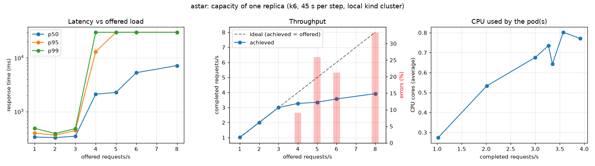
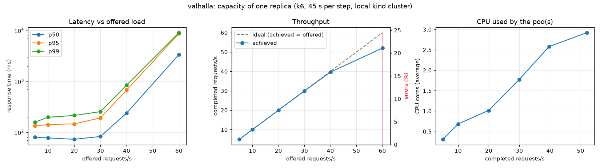
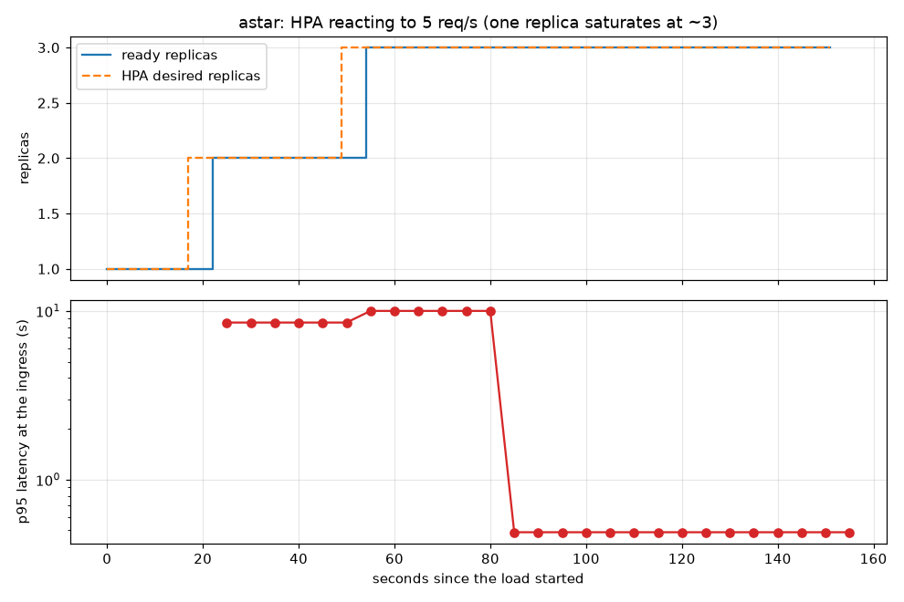

# Capacity report

How much load can each routing service take, where does it break, and what should the CPU requests and
autoscaler thresholds be? Everything below was measured with [k6](https://k6.io) against the services through the
Traefik Ingress on the local `kind` cluster; the raw data is in `loadtest/results/`.

## Summary

| | A\* backend (custom, Python) | Valhalla |
|---|---|---|
| **Capacity of one replica** (the "knee") | **about 3 requests/s** | **about 30 requests/s** |
| Latency just below the knee (p95) | 0.44 s at 3 req/s | 0.19 s at 30 req/s |
| What happens past the knee | latency jumps from 0.4 s to 13 s and requests time out at 30 s | p95 rises to 0.7 s at 40 req/s, then 8.7 s with 24% errors at 60 req/s |
| CPU per request/second | 0.23 to 0.27 cores | 0.05 to 0.07 cores |
| Memory | flat at ~430 MiB at every load | 139 to 172 MiB |
| Why | single-threaded Python: one request at a time, so it pins exactly **one core** | multi-threaded, uses up to ~3 cores |

Valhalla serves roughly **ten times** the traffic per replica at a third of the latency.

## Method

- **Load generator:** k6 with the `constant-arrival-rate` executor. It holds the *request rate* fixed however slowly
  the server answers. A fixed number of virtual users would slow down together with the server and hide overload.
- **Steps:** each offered rate runs for 45 seconds, followed by a 20-second cooldown. Rates rise until the service breaks.
- **Realistic requests:** 300 random trips of 2 to 6 km between real road nodes, each verified to be routable by *both*
  engines first (`loadtest/make_points.py`), so a failure means overload and not bad input.
- **Resource use:** for each step, Prometheus is asked what CPU and memory the pods used during exactly that window
  (skipping the first 10 seconds of warm-up).
- **One replica:** the autoscaler was pinned to a single replica during the step tests, so they measure one pod.

```bash
python loadtest/run.py astar 1 2 3 4 5 6 8
python loadtest/run.py valhalla 5 10 20 30 40 60
python loadtest/plot.py astar valhalla
python loadtest/hpa_validate.py astar 5 150
```

## A\* backend



| Offered (req/s) | Achieved | p50 | p95 | p99 | Errors | CPU avg (cores) | Memory max |
|---|---|---|---|---|---|---|---|
| 1 | 1.0 | 336 ms | 398 ms | 485 ms | 0% | 0.27 | 429 MiB |
| 2 | 2.0 | 327 ms | 364 ms | 390 ms | 0% | 0.53 | 429 MiB |
| 3 | 3.0 | 348 ms | 443 ms | 481 ms | 0% | 0.68 | 429 MiB |
| 4 | 3.3 | 2.1 s | 13.0 s | 30.0 s | 9% | 0.73 | 429 MiB |
| 5 | 3.4 | 2.3 s | 30.0 s | 30.0 s | 26% | 0.64 | 431 MiB |
| 6 | 3.6 | 5.3 s | 30.0 s | 30.0 s | 21% | 0.80 | 431 MiB |
| 8 | 3.9 | 7.2 s | 30.0 s | 30.0 s | 33% | 0.77 | 431 MiB |

Up to 3 requests/s latency is flat at about 0.35 s. At 4 it collapses, and achieved throughput stops growing near
3.3 to 3.9 req/s however much more is offered. A request takes about 0.33 s of service time on one thread, so one
replica can finish at most about 3 per second; anything above that queues, and queued requests wait until they time out.

## Valhalla



| Offered (req/s) | Achieved | p50 | p95 | p99 | Errors | CPU avg (cores) | Memory max |
|---|---|---|---|---|---|---|---|
| 5 | 5.0 | 80 ms | 134 ms | 159 ms | 0% | 0.31 | 139 MiB |
| 10 | 10.0 | 78 ms | 142 ms | 198 ms | 0% | 0.68 | 143 MiB |
| 20 | 20.0 | 73 ms | 147 ms | 215 ms | 0% | 1.02 | 143 MiB |
| 30 | 29.9 | 83 ms | 192 ms | 255 ms | 0% | 1.77 | 148 MiB |
| 40 | 39.6 | 240 ms | 680 ms | 847 ms | 0% | 2.58 | 152 MiB |
| 60 | 52.0 | 3.4 s | 8.7 s | 9.1 s | 24% | 2.92 | 172 MiB |

Latency stays under 0.2 s through 30 req/s, degrades at 40 and breaks at 60. CPU keeps growing with load up to about
3 cores, so unlike the A\* backend it is not capped at one core.

## What the numbers changed

These were the settings before the test, all guesses, and what they became.

| Setting | Before | After | Why |
|---|---|---|---|
| A\* CPU request | 100m | **600m** | At a 70% HPA target, 100m meant scaling out at 0.07 cores, around 0.3 req/s, which is almost any traffic. With 600m it scales out at 0.42 cores (about 1.6 to 1.9 req/s), roughly half the knee, which leaves room for the time a new pod needs to start. |
| A\* memory | 512Mi / 768Mi | unchanged | Measured 429 MiB at every load, so the 768Mi limit is 1.8 times the real use. |
| Valhalla CPU request | 250m | **1000m** | About 1.0 core at 20 req/s, a comfortable operating point two thirds of the way to the knee. |
| Valhalla memory | 512Mi / 2Gi | **256Mi / 1Gi** | Peak 172 MiB. The limit stays generous because only central Tokyo was queried and the tiles are memory-mapped. |

Valhalla has no autoscaler (it writes to a single volume, see the README), so its capacity is vertical: about 30
req/s per replica on this machine.

## Does the autoscaler protect the service?

A\* was offered 5 req/s, above one replica's knee, while the HPA (min 1, max 3, 70% target) was active.



| Time since load started | Event |
|---|---|
| 17 s | HPA decides to add a replica (CPU well above 70% of the request) |
| 22 s | second replica Ready |
| 49 s | HPA adds the third |
| 54 s | third replica Ready |
| about 80 s | p95 latency at the ingress back to **0.49 s** and stays there |

So the service was degraded for about 80 seconds after the load began and then recovered by itself. Two details matter:

- **Latency recovers after the replicas are ready, not at the same moment**, because the saturated first replica still
  has a backlog to drain. (The plotted curve also lags: the latency query uses a 1-minute window, since
  Prometheus scrapes every 30 s.)
- **After scaling out, CPU settled at 84 to 92% of the request, above the 70% target.** The HPA wanted more than 3
  replicas and was held at `maxReplicas: 3`. Three replicas coped with 5 req/s, but there is little headroom beyond
  it. `values-prod.yaml` allows 5.

## Limits of this test

- **Everything shares one laptop.** k6, Traefik, the cluster, Prometheus and Grafana all compete for the same CPU, so
  absolute numbers are lower than on dedicated hardware. Treat the *shape* (where the knee is, how services compare)
  as the finding, not the exact figures.
- **Only central-Tokyo trips of 2 to 6 km** were tested. Longer routes cost the A\* backend more.
- **45-second steps** show short-term behaviour, not long-run stability or memory growth over hours.
- **Latency percentiles above 10 s are capped** by the top histogram bucket in Prometheus; k6's own numbers are exact
  and are the ones in the tables.
- **One run per step**, no repetition, so there are no confidence intervals.

## What I would do next

1. **Fix the real bottleneck in A\*.** It is CPU-bound pure Python on a single thread, so more threads would not
   help (the GIL). The options are several worker processes behind the same port, or a faster implementation. Adding
   replicas works but costs ~430 MiB each.
2. **Raise `maxReplicas`** (or add a memory-aware cap) once more than ~5 req/s is expected.
3. **Scale out earlier or faster.** Lower the HPA target, or add a `behavior.scaleUp` policy, if a minute of
   degradation is too long for the use case.
