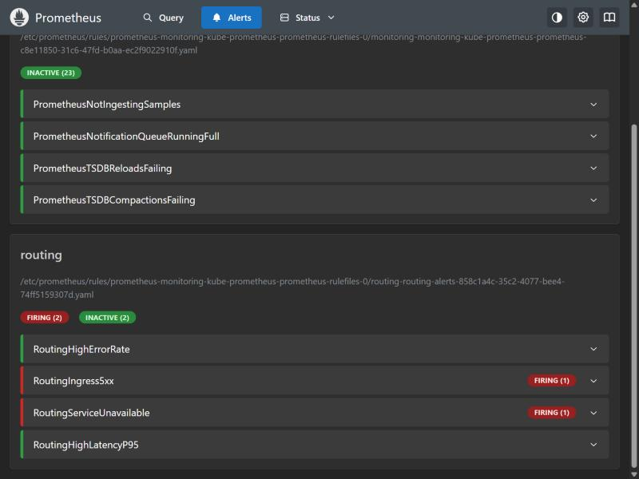

# Monitoring

Prometheus, Alertmanager and Grafana (the `kube-prometheus-stack` chart) run on the local `kind` cluster,
installed by `terraform/local`. The application ships its own dashboard and alert rules inside the Helm chart
(`monitoring.enabled=true`; off by default so the chart installs on clusters without the Prometheus CRDs).

## What is measured, and where it comes from

None of the three services exposes Prometheus metrics itself, so the signals come from the platform:

| Signal | Source |
|---|---|
| Request rate, p95/p99 latency, error rate per service | **Traefik's own metrics** at the ingress (the "RED" metrics) |
| Everything a client sees, including `503`s Traefik generates itself | Traefik **entrypoint** metrics |
| Pod CPU and memory | cAdvisor, scraped by Prometheus from the kubelet |
| Replica counts, HPA current/desired | kube-state-metrics |

Dashboard: *Routing platform overview* (10 panels, provisioned from a ConfigMap labelled `grafana_dashboard=1`).

## Alerts

| Alert | Fires when | Severity |
|---|---|---|
| `RoutingHighErrorRate` | a service's backends return 5xx on more than 5% of its requests for 2 minutes | warning |
| `RoutingIngress5xx` | more than 5% of **all** requests through the ingress fail with 5xx for 2 minutes | critical |
| `RoutingServiceUnavailable` | a Deployment has no available replicas for 1 minute | critical |
| `RoutingHighLatencyP95` | a service's p95 latency is above 2 s for 5 minutes | warning |

The rules are checked with `promtool check rules` before they are deployed.

## Using it

```bash
cd terraform/local && terraform apply
kubectl -n monitoring port-forward svc/monitoring-grafana 3000:80          # http://localhost:3000
kubectl -n monitoring port-forward svc/monitoring-kube-prometheus-prometheus 9090:9090
```

Grafana's admin password is generated by Terraform and never written to a file:
`terraform output -raw grafana_admin_password`. The local stack also enables anonymous **read-only** (Viewer)
access, because Grafana is reachable only through a `localhost` port-forward. That setting is local-only and must
not be copied to a shared or cloud cluster.

## Demonstration: a deliberate outage

Valhalla has no autoscaler to quietly undo an outage, so it was scaled to zero while a script kept sending
route requests through the ingress. Every request to it then returned `503`.



| Run | What happened |
|---|---|
| 1 (first rule set) | `RoutingServiceUnavailable` fired. `RoutingHighErrorRate` stayed silent for over six minutes even though every Valhalla request failed (see below). |
| 2 (after adding `RoutingIngress5xx`) | Outage began 21:02:55. Both `RoutingIngress5xx` and `RoutingServiceUnavailable` were firing at 21:06:03, about three minutes later. The ingress 5xx share peaked at roughly 65% (half the traffic went to Valhalla). Restoring Valhalla ended it. |

The Grafana dashboard itself was verified through Grafana's HTTP API (it loads, with all panels and the
corrected queries) and the queries behind every panel were run against live Prometheus data. A Grafana
screenshot is not included: the Claude browser pane refused to open `localhost:3000` while Prometheus's own
port opened normally, and this was not worked around.

## Two things that went wrong (and what they taught)

1. **Label collision made every query return nothing.** Traefik labels its metrics with `service`, and a
   `ServiceMonitor` also stamps every scraped target with a `service` label. On a clash Prometheus keeps its own
   and renames Traefik's to `exported_service`, so every dashboard and alert query on `service` matched
   nothing, silently. The fix is `honorLabels: true` on the ServiceMonitor. The symptom was an empty graph, not
   an error, which is why dashboards need to be tested against real traffic.
2. **The first error-rate alert could not see the most common outage.** When a Service has no endpoints,
   Traefik answers `503` itself at the entrypoint and records nothing against the service. A per-service
   5xx-rate alert therefore stayed silent while 100% of requests to Valhalla failed, and only the separate
   replica-count alert fired. The fix was an entrypoint-level alert and dashboard panel
   (`RoutingIngress5xx`). The lesson: alert on what the *client* experiences, not only on what each backend
   reports.

A smaller one: the Terraform Helm provider does not re-deploy a local chart when only files inside it change;
it needs the chart `version` bumped. Config checksum annotations hash the config data, not the rendered
object, so a version bump does not restart pods.

## Limits

- Latency percentiles come from histogram buckets (0.05 to 10 s), so they are approximate.
- Prometheus keeps 12 hours of data and nothing is persisted: this is a local demonstration setup.
- Alertmanager has no receivers configured, so alerts are visible in the UI but are not delivered anywhere.
